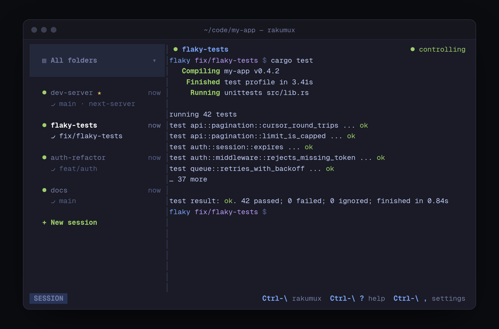

# Rakumux

**Terminal sessions for coding agents, in one fast terminal UI.**

[rakumux.com](https://rakumux.com) · [Source](https://github.com/humanunsupervised/rakumux) · [Releases](https://github.com/humanunsupervised/rakumux/releases)

楽 (*raku*) means easy, and read *gaku* it means music: tmux, made easy.



Run Claude Code, Codex, OpenCode, Pi, dev servers, and shells side by side. A small background
daemon owns your terminals, so sessions keep running when you close the UI or lose an SSH
connection.

- See every folder's sessions, with live previews and agent status.
- Filter, rename, reorder, and pin sessions without managing worktrees.
- Switch between your program and Rakumux with `Ctrl-\`.
- Use the CLI, local HTTP API, or Model Context Protocol (MCP) server to drive sessions.
- Pair a separate mobile client over opt-in Tailscale access.

## Build and run

Requires a stable Rust toolchain, a C compiler, and bash on macOS or Linux. SQLite is bundled.
Git and tmux are not runtime dependencies.

```bash
git clone https://github.com/humanunsupervised/rakumux.git
cd rakumux
./build.sh
./rakumux.sh
```

The recommended binary installer is:

```bash
curl -fsSL https://rakumux.com/install.sh | bash
```

The installer verifies the release checksum before running the tarball's installer. Re-run it
to upgrade. npm and Homebrew publishing are not enabled. See the
[installation guide](install/INSTALL.md) for binary and release-tarball instructions.

## Quick start

In the UI, press `n` to create a session. Run an agent or any command in its shell.
Press `Ctrl-\` to return to Rakumux mode. Use `j`/`k` or the arrow keys to select a session,
`Enter` to work in it, and `?` for Help. Quitting the UI does not stop sessions.

```bash
rakumux new --name dev          # Create and attach
rakumux ls --all                # List sessions across folders
rakumux attach dev              # Full-screen attach; Ctrl-\ then d detaches
rakumux daemon status
rakumux --help
```

From a checkout, use `./rakumux.sh` instead of `rakumux`.

## Agent integration

```bash
claude mcp add --scope user rakumux -- rakumux-mcp
```

See the [MCP guide](mcp/README.md) for Codex, OpenCode, tool permissions, and session identity.
The [HTTP API guide](api/README.md) describes local automation and remote access.

Sessions and settings live in `~/.rakumux`. Set `RAKUMUX_HOME` to use an isolated data directory.
Optional AI naming uses your own Anthropic or OpenAI key; no account or key is needed for terminal
sessions. Remote access is off until explicitly enabled.

## Development

```bash
cd tui
cargo build --workspace --locked
cargo test --workspace --locked
cargo fmt --all --check
```

Read [CONTRIBUTING.md](CONTRIBUTING.md) for checks and the
[architecture](AGENTS.md) for module boundaries. The website lives in [`landing/`](landing/README.md).
The mobile app is maintained separately in `humanunsupervised/rakumux-mobile`; its source is not
part of this repository or this repository's license grant.

## License

Copyright 2024–2026 Antonio de Perio and Human Unsupervised Pty Ltd.

Rakumux is licensed under [Apache-2.0](LICENSE). Dependencies retain their own licenses;
binary releases include `THIRD_PARTY_NOTICES`. The license does not grant rights to Rakumux
trademarks. See [SECURITY.md](SECURITY.md) to report a vulnerability privately.
